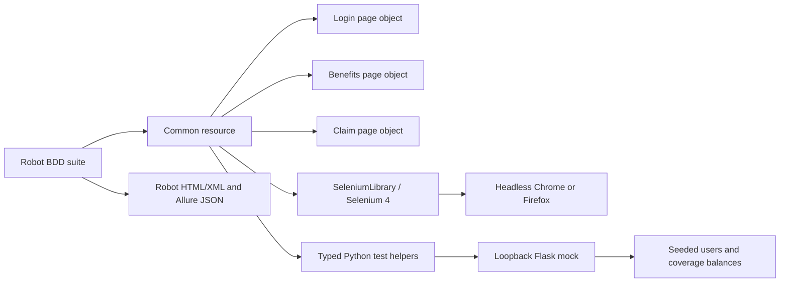

# Group Benefits Portal test automation

This repository is a runnable portfolio and interview example for browser-test
automation with Robot Framework 7, SeleniumLibrary, Selenium 4, and a small Flask
mock. The mock is a deliberately simplified **test-framework development tool**:
it is not a real benefits application, is not suitable for production, and has no
deployment stage.

The default test target starts its own mock on loopback with a free port, waits
for the mock's ready signal and health endpoint, resets state before every test,
and then runs browser scenarios without credentials or an external application.
An external disposable test portal can be selected with environment variables.

## Architecture

Page-specific selectors and UI actions are kept in Robot Framework resource
files. Python helpers handle settings validation, browser options, and the mock
server lifecycle. The Flask application owns the seeded test data and validates
claims server-side.



The `output.xml` file is Robot Framework output. Allure produces JSON files in
`results/allure-results`; these files are not XML.

## Seed data and covered behavior

The local mock seeds one active member and one disabled member. The local-only
login values are `member@example.test` / `MockBenefits!2026`. The disabled test
account is `locked-member@example.test` / `DisabledMember!2026`; it must not be
able to authenticate. These values are public mock fixtures, not production
credentials.

| Coverage | Limit | Remaining at reset |
|---|---:|---:|
| Health | $2,500.00 | $1,200.00 |
| Dental | $1,500.00 | $800.00 |

Claims require a coverage type, positive amount, ISO service date, and
description. The server accepts exactly the remaining balance, rejects one cent
above it, rejects zero and negative values, and reduces the selected balance
only after a valid submission. `POST /__reset` restores the seeded state and
clears the session. It is intentionally available only on the loopback test
mock.

## Prerequisites

- Python 3.11 or newer.
- GNU Make for the Makefile commands.
- Chrome and/or Firefox installed locally. Selenium Manager obtains compatible
  drivers automatically; this project does not install or manage drivers.
- The Allure command-line application only if you want to render or serve the
  JSON Allure results. The Python `allure-robotframework` listener writes the
  results and is installed with the project dependencies.

## Download and run the local demo

These steps let anyone clone the repository and run the demo on their
own computer. The default configuration uses the included local mock, so no
portal account, external application, or `.env` file is needed.

1. Install Git, Python 3.11 or newer, and at least one supported browser
   (Chrome or Firefox). To run both browser demos, install both browsers.
2. On the repository page in GitHub, select **Code**, copy the HTTPS URL, then
   open a terminal and clone it. Replace the example URL with the copied URL:

   ```text
   git clone https://github.com/USERNAME/REPOSITORY.git
   cd REPOSITORY
   ```

3. Create a virtual environment and install the pinned dependencies.

   **Windows PowerShell:**

   ```powershell
   py -3 -m venv .venv
   .\.venv\Scripts\Activate.ps1
   python -m pip install --upgrade pip
   python -m pip install -r requirements.lock.txt
   ```

   If PowerShell blocks activation, either allow it for the current terminal
   with `Set-ExecutionPolicy -Scope Process -ExecutionPolicy Bypass`, or skip
   activation and run `.\.venv\Scripts\python.exe` instead of `python` in the
   commands below.

   **macOS or Linux:**

   ```bash
   python3 -m venv .venv
   source .venv/bin/activate
   python -m pip install --upgrade pip
   python -m pip install -r requirements.lock.txt
   ```

4. Run the full browser demo. The first run may take a little longer while
   Selenium Manager downloads a compatible browser driver.

   **Chrome (default):**

   ```text
   python libraries/run_robot.py --outputdir results tests/group_benefits.robot
   ```

   **Firefox:**

   ```text
   python libraries/run_robot.py --variable BROWSER:firefox --outputdir results tests/group_benefits.robot
   ```

   The browser runs headless by default. No server setup is required: the suite
   starts the Flask mock on `127.0.0.1`, waits for it to be ready, resets its
   seeded data for each test, and shuts it down after the suite. A successful
   run reports 12 passing browser tests.

   If GNU Make is installed, the equivalent shortcuts are `make test` and
   `make test-firefox`. To run a visible Chrome window in PowerShell, set
   `$env:HEADLESS = "false"` before running the Chrome command; in macOS/Linux,
   use `HEADLESS=false` before the command.

5. Open `results/report.html` in a browser to review the test summary, or open
   `results/log.html` for keyword-level details. Robot's machine-readable output
   is `results/output.xml`; Allure listener results are JSON files in
   `results/allure-results`. To run the helper and mock API tests as well:

   ```text
   python -m pytest
   ```

If browser startup fails, check that the selected browser is installed and can
be launched on the machine, that the machine can reach the internet on the
first run for Selenium Manager, and that the virtual environment is activated
(or use its Python executable directly). The standard demo should leave
`PORTAL_URL` unset; setting it switches to external-portal mode and requires
credentials and a compatible test site.

The runtime and development package versions in `pyproject.toml` were checked
against PyPI on 2026-10-29. `requirements.lock.txt` is generated from those
declared dependencies and pins the resolved dependency graph. Regenerate it
after changing dependency declarations with:

```powershell
python -m piptools compile --extra dev --generate-hashes --output-file requirements.lock.txt pyproject.toml
```

## Local setup

Create and activate a virtual environment, then install the lock:

```powershell
py -3.12 -m venv .venv
.\.venv\Scripts\Activate.ps1
python -m pip install --upgrade pip
python -m pip install -r requirements.lock.txt
```

On macOS or Linux, use `python3 -m venv .venv` and
`source .venv/bin/activate`. Alternatively, `make setup` creates `.venv` and
installs the lock file.

The `.env.example` file documents local settings, but no dotenv dependency is
used: the test process reads operating-system environment variables directly.
The local mock and seeded credentials are defaults, so no environment setup is
needed for the standard run.

## Run the suite

```powershell
make test
make test-firefox
```

Both targets run headless by default. To run headed, set `HEADLESS=false` in the
process environment before invoking `make test`. Window size and wait timeout
are configured with `WINDOW_SIZE` (default `1440x1000`) and `TIMEOUT` (default
`10` seconds). Chrome receives `--no-sandbox` only when `CI=true`.

Run a tagged subset with `make test ROBOT_ARGS="--include smoke"` or pass another
Robot Framework CLI option through `ROBOT_ARGS`. Useful tags include `smoke`,
`auth`, `balance`, `claim`, `negative`, `health`, `dental`, and `regression`.

The focused helper/API test suite and quality checks are:

```powershell
python -m pytest
make lint
make typecheck
```

`make lint` runs Ruff, Robocop, and Robotidy checks. `make typecheck` runs
`mypy --strict` over all project Python modules and unit tests. Use
`make report` to regenerate Robot Framework HTML/XML reports from the last
`results/output.xml`.

The Robocop command leaves `SPC03` to Robotidy's formatter and suppresses
`MISC04`/`VAR05` for the intentional suite-scoped URL variable created after
the mock binds its random port. All other Robocop rules remain enabled.

## Reports and diagnostics

Each browser run writes:

- `results/output.xml`, `results/log.html`, and `results/report.html` from Robot.
- Allure JSON in `results/allure-results`.
- Failure screenshots in `results/screenshots`.
- The local mock server log in `results/mock-portal.log`.

Open `results/report.html` or `results/log.html` in a browser. To render Allure,
install the Allure command-line application separately and run
`allure serve results/allure-results`. The generated report is temporary and
served locally by the Allure CLI.

## External portal mode

Set `PORTAL_URL`, `PORTAL_USERNAME`, and `PORTAL_PASSWORD` in the process
environment to use an external portal. External mode fails before opening a
browser if either credential is missing. `BROWSER` accepts only `chrome` or
`firefox`. Use only a disposable test environment: external tests submit claims,
and the framework deliberately does not call the mock-only reset endpoint on an
external host.

The example locator variable file is
`config/external_locators.example.py`. Copy and adapt it as a Robot variable file,
then pass it with `--variablefile` (for example through `ROBOT_ARGS`). Every
locator in the mock uses a stable `data-testid`; real portal locators often need
overriding. An external application must implement the same user journeys and
provide equivalent test data, or its tests need deliberate adaptation.

## Jenkins setup

Install Jenkins with the Pipeline, Git, Credentials Binding, Robot Framework,
Allure, and Workspace Cleanup plugins. Configure a Linux agent with Python 3.11
or newer, GNU Make, Chrome and Firefox, and an outbound network route to
download Python packages and Selenium Manager drivers.

Create a Pipeline job pointing at this repository's `Jenkinsfile`. Configure
the job or global environment variable `REPO_CREDENTIALS_ID` only when a private
Git repository needs a Jenkins Git credential. Public repositories need no
checkout credential. Create the following secret-text credentials only when
external test credentials are needed:

- `benefits-test-email`
- `benefits-test-password`

Credentials are bound only during the external-credentials run and are never
echoed. Set `USE_EXTERNAL_CREDENTIALS` only together with a disposable external
`PORTAL_URL`.

The Jenkins parameters are `GIT_REF`, `GIT_SHA`, `REPO_URL`, `BROWSER`,
`PORTAL_URL`, `TAGS`, and `USE_EXTERNAL_CREDENTIALS`. `GIT_SHA` can be used to
verify that the requested ref resolved to the expected triggering commit.
`BROWSER` is constrained to Chrome or Firefox. Blank `PORTAL_URL` selects the
local mock. An empty `TAGS` runs the whole suite.

The GitHub workflow's trusted-change job submits a REST
`buildWithParameters` request, reads Jenkins' queue `Location`, waits for a build
number, then polls the build result. It requires the following repository
configuration:

| Type | Exact name | Purpose |
|---|---|---|
| Secret | `JENKINS_USER` | Jenkins user associated with the API token |
| Secret | `JENKINS_API_TOKEN` | Jenkins API token; never a user password |
| Variable | `JENKINS_URL` | HTTPS base URL for Jenkins |
| Variable | `JENKINS_JOB_NAME` | Jenkins job name, or slash-separated folder/job path |

The Jenkins account needs permission to build the configured job and read its
queue and build status. Use HTTPS for the Jenkins URL.

## GitHub Actions behavior

Pushes, manual runs, and same-repository pull requests delegate to Jenkins. A
pull request from a fork does not receive Jenkins secrets and cannot trigger the
Jenkins job. Instead, a separate secret-free job runs unit tests and the local
mock browser suite in Chrome and Firefox, then uploads `results/**` as an
artifact even when validation fails. The workflow pins each action to a full
commit SHA and grants only `contents: read`.

For trusted changes, the Jenkins URL and result are recorded in the GitHub job
summary. Jenkins archives Robot reports, screenshots, and Allure JSON. Fork
validation artifacts are attached directly to the GitHub Actions run. Neither
path deploys an application.

## Design decisions and interview talking points

- The test-owned free port avoids collisions between local sessions and CI jobs.
  The child process writes a ready signal only after binding, and the suite then
  verifies `/health` before opening a browser.
- A `POST /__reset` suite fixture makes each test order-independent and resets
  both balances and authentication state.
- Page objects separate selectors and page actions from BDD scenarios. Stable
  `data-testid` selectors avoid brittle text and layout-based locators.
- Claim amounts use `Decimal`, not binary floating-point, for exact cent
  comparisons and the one-cent-over-limit edge case.
- Flask validates submissions on the server even when browser-side `required`
  validation is bypassed in the missing-fields test.
- Selenium Manager supplies browser drivers; the project installs no driver
  binaries and does not use `webdriver-manager`.
- External portal mode is opt-in and requires credentials, but only the local
  mock can be reset automatically. A real external system must be disposable.
- CI forks run without secrets; trusted build delegation and fork validation
  use distinct conditional jobs.

## Manual setup required

- Install Python 3.11 or later and GNU Make.
- Install Chrome and Firefox for the browsers you intend to run.
- Install the Allure CLI only if you want to view a rendered Allure report.
- Configure Jenkins plugins, its Linux browser agent, and the Pipeline job.
- Add the four GitHub repository secrets/variables when Jenkins delegation is
  enabled.
- Create the two Jenkins test credentials only for external portal runs.
- Keep any external portal disposable and supply its credentials through
  environment variables or Jenkins credentials.

## Assumptions

- A local test run uses the mock unless `PORTAL_URL` is non-empty.
- The user account and balances shown above are intentionally public fixtures.
- External portal pages need the same workflow and compatible locators; merely
  setting an external URL does not adapt an unrelated application.
- Jenkins is reachable over HTTPS from GitHub Actions, accepts API-token
  authentication, and exposes normal queue and build JSON endpoints.
- A Jenkins agent already has the requested browsers installed; Selenium
  Manager resolves matching drivers at runtime.

This project produces test reports and diagnostics only. It does not deploy a
production app.
